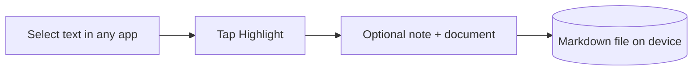

# Highligher

[](https://kotlinlang.org)
[](https://www.android.com)
[](https://developer.android.com/jetpack/compose)
[](#license)

**Capture highlights from anywhere on Android into clean, portable Markdown. No account. No cloud. Your notes stay yours.**

Highligher is an offline-first Android app that turns selected text into organized Markdown knowledge documents. Select text in any app, tap **Highlight**, and it is appended to a Markdown document with a stable marker, ready to read in any editor.

## Why

Reading on a phone means losing the good parts. Screenshots pile up, links rot, and notes end up scattered across apps you cannot export from. Highligher keeps the capture step to seconds and keeps the output portable.

1. Capture should take seconds.
2. Organizing should require minimal effort.
3. Highlights accumulate in one Markdown document, not one file per highlight.
4. Everything works offline.
5. Markdown stays readable outside the app. No lock-in.

## How it works

Android's text-selection toolbar includes a **Highlight** entry (via `ACTION_PROCESS_TEXT`). Tapping it opens a small capture sheet, appends the highlighted text to a Markdown file, and returns you to what you were reading.



Each highlight is appended as a block with a stable `<!-- highlight:id -->` marker so appends never corrupt earlier content.

## Features

- **Capture from anywhere** via Android's text-selection menu
- **Folders + documents** with Markdown as the source of truth
- **Markdown editor** with a toolbar for bold, italic, underline, lists, and indent
- **Home, Library, Search, and Settings** screens
- **Offline-first** — no account, no network required for core use

## Install

Grab the debug APK from the [Releases](https://github.com/josholaf/Highligher/releases) page (or from the latest [Actions run](https://github.com/josholaf/Highligher/actions) artifact), enable "Install unknown apps" for your browser if prompted, and install.

Requirements: Android 8.0 (API 26) or newer.

> The APK is a debug build signed with a debug key. Fine for testing, not for distribution.

## Build from source

```bash
git clone https://github.com/josholaf/Highligher.git
cd Highligher
gradle assembleDebug   # APK at app/build/outputs/apk/debug/app-debug.apk
```

Or open the project in Android Studio, sync Gradle, and run on a device or emulator.

To capture: open Chrome, select text, and choose **Highlight** from the selection menu.

## Roadmap

- [ ] Room-backed search across all documents
- [ ] Export and backup (SAF, share sheet)
- [ ] Tags and document templates
- [ ] F-Droid release

## Project structure

```
app/src/main/java/com/josholaf/highligher/
├── HighligherApp.kt       # @HiltAndroidApp entry point
├── MainActivity.kt        # Library home (Compose)
├── CaptureActivity.kt     # ACTION_PROCESS_TEXT capture sheet
├── domain/model/Models.kt # Folder, Document, Highlight, Tag
└── ui/theme/Theme.kt      # Material 3 theme and palette
```

## Stack

| Layer | Choice |
| ----- | ------ |
| Language | Kotlin 2.0 |
| UI | Jetpack Compose + Material 3 |
| Architecture | MVVM + Hilt |
| Documents | Markdown files on device storage |
| Capture | `ACTION_PROCESS_TEXT` (text selection menu) |
| CI | GitHub Actions, debug APK on every push |

## Design

| Token | Value |
| ----- | ----- |
| Deep forest | `#17231D` |
| Highlight green | `#78B68A` |
| Paper | `#F3F1E9` |
| Warm accent | `#C6A66A` |

## Contributing

Issues and pull requests are welcome. Keep PRs small and focused, and open an issue before large changes.

## License

Not chosen yet. The code is public, but no license has been applied, so all rights are reserved by default. If you want to use it, open an issue and a license will be picked.
